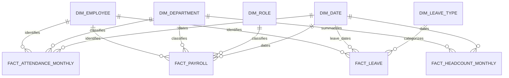

# PulseIQ Data Warehouse Schema

## 1. Overview

The PulseIQ data warehouse uses a PostgreSQL 16 database and a dimensional model to support workforce, attendance, payroll, leave, and headcount analytics.

The warehouse schema is stored in the `dw` database schema. The ETL pipeline loads source data into dimension and fact tables and supports repeatable, idempotent loads.

## 2. Dimension Tables

| Table | Purpose |
|---|---|
| `dw.dim_employee` | Employee details with historical versions using effective dates and a surrogate employee key. |
| `dw.dim_department` | Department names, cost centers, and department attributes. |
| `dw.dim_role` | Job roles, levels, grades, and salary-band information. |
| `dw.dim_date` | Calendar and financial date attributes for time-based analysis. |
| `dw.dim_leave_type` | Leave categories and associated policy attributes. |

### Employee History

`dw.dim_employee` maintains employee assignment history using:

- `employee_key`: Surrogate key for each employee version.
- `employee_id`: Business identifier shared across versions.
- `valid_from` and `valid_to`: Effective date range for each version.
- `is_current`: Indicates the current employee version.
- `change_reason`: Describes the assignment change.

This design supports historical analysis when an employee changes department or role.

## 3. Fact Tables and Grain

| Fact table | Grain — one row represents | Main measures |
|---|---|---|
| `dw.fact_attendance_monthly` | One employee per reporting month | Scheduled days, present days, leave days, late arrivals, hours worked, attendance rate |
| `dw.fact_payroll` | One payroll item per payroll run | Gross pay, deductions, net pay, overtime pay, employer cost |
| `dw.fact_leave` | One leave request | Leave duration, leave type, request status |
| `dw.fact_headcount_monthly` | One department per month | Starting headcount, hires, exits, transfers, ending headcount, attrition rate |

## 4. Relationships

- `fact_attendance_monthly` references employee, date, and department information.
- `fact_payroll` references employee, date, department, and role information.
- `fact_leave` references employee, leave type, and start/end dates.
- `fact_headcount_monthly` references date and department information.
- `dim_employee` uses `employee_key` to link facts to the appropriate employee version.

## 5. Schema Diagram

The diagram shows the logical relationships between dimensions and facts. Employee history is maintained through effective-dated rows in `dim_employee`.

## 6. Data Loading and Reliability

The ETL loader reads the source workbooks, prepares dimension and fact data, and upserts records into PostgreSQL. Unique keys and conflict-handling logic support repeatable loads without duplicating records.

Validation checks cover payroll totals, employee counts, department-month headcount metrics, and repeat-load row counts.

## 7. Indexing

Indexes support common analytical access patterns, including current employee versions, attendance periods, payroll periods and runs, leave dates, and department-level monthly headcount.

## 8. Data Quality Notes

Warehouse results are validated against the supplied reference summaries. Payroll and headcount validations matched the reference data in the checks performed. Attendance metrics require separate consideration because monthly feature aggregates and daily attendance records can produce different results.
