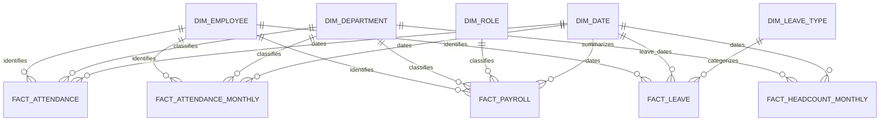

# PulseIQ Data Warehouse Schema

## 1. Overview

The PulseIQ data warehouse uses PostgreSQL 16 and a dimensional model to support workforce, daily and monthly attendance, payroll, leave, and headcount analytics.

The warehouse tables are maintained under the `dw` schema. The ETL pipeline loads source workbooks into dimension and fact tables and supports repeatable, idempotent loads.

## 2. Dimension Tables

| Table | Purpose |
|---|---|
| `dw.dim_employee` | Employee details and historical versions using effective dates and a surrogate employee key. |
| `dw.dim_department` | Department names, cost centers, and department attributes. |
| `dw.dim_role` | Job roles, levels, grades, and salary-band information. |
| `dw.dim_date` | Calendar and financial date attributes for time-based analysis. |
| `dw.dim_leave_type` | Leave categories and associated policy attributes. |

### Employee History

`dw.dim_employee` maintains employee assignment history using:

- `employee_key`: Surrogate key for each employee version.
- `employee_id`: Business identifier shared across versions.
- `valid_from` and `valid_to`: Effective date range for each version.
- `is_current`: Indicates the current employee version.
- `change_reason`: Describes the assignment change.

This design supports historical analysis when an employee changes department or role.

## 3. Fact Tables and Grain

| Fact table | Grain — one row represents | Main measures |
|---|---|---|
| `dw.fact_attendance` | One employee per attendance date | Status, hours worked, overtime hours, late flag |
| `dw.fact_attendance_monthly` | One employee per reporting month | Scheduled days, present days, leave days, late arrivals, hours worked, attendance rate |
| `dw.fact_payroll` | One employee per payroll period | Gross pay, deductions, net pay, overtime pay, employer cost |
| `dw.fact_leave` | One leave request | Leave duration, leave type, request status |
| `dw.fact_headcount_monthly` | One department per month | Starting headcount, hires, exits, transfers, ending headcount, attrition rate |

### Daily Attendance

`dw.fact_attendance` stores daily attendance records from the master workbook. The `attendance_id` is the primary key, and the table enforces uniqueness for `(employee_id, attendance_date)` to prevent duplicate employee-day records.

### Payroll

`dw.fact_payroll` enforces uniqueness for `(employee_id, period_end_date)` to prevent duplicate payroll records for the same employee and payroll period.

## 4. Relationships

- `fact_attendance` references employee, date, and department information.
- `fact_attendance_monthly` references employee, date, and department information.
- `fact_payroll` references employee, date, department, and role information.
- `fact_leave` references employee, leave type, and start/end dates.
- `fact_headcount_monthly` references date and department information.
- `dim_employee` uses `employee_key` to link facts to the appropriate employee version.

## 5. Schema Diagram

The diagram represents the logical relationships between dimensions and facts. Employee history is maintained through effective-dated rows in `dim_employee`.

## 6. Data Loading and Reliability

The ETL loader reads source workbooks, prepares dimension and fact data, and upserts records into PostgreSQL. Unique keys and conflict-handling logic support repeatable loads.

The loader processes dimensions, daily attendance, monthly attendance, payroll, leave requests, and monthly headcount.

## 7. Validation Results

The automated test suite completed with **6 passing tests**.

Reference validation results:

- Payroll: 198 reference rows matched; zero metric mismatches.
- Headcount: 198 reference rows matched; zero metric mismatches.
- Attendance: 198 reference rows matched, with two late-arrival differences of one record and three small attendance-rate differences.

Attendance comparisons use daily master attendance records. The separate monthly attendance feature source should not be assumed to produce identical aggregates. The observed reference differences are documented rather than hidden by changing the data or widening validation tolerances.

## 8. Indexing and Data Quality

Indexes support analytical queries involving employee versions, attendance dates, payroll periods, leave dates, and department-level monthly headcount.

Primary keys, unique constraints, conflict-handling logic, automated tests, and reference validation help maintain warehouse reliability.
